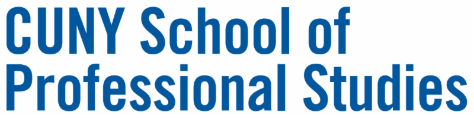

```{r, echo=FALSE, warning=FALSE, message=FALSE, error=FALSE, results='hide'}
source('config.R')
options(knitr.kable.NA = "")
```

```{r, echo=FALSE, fig.align='center', out.width='50%'}

```


# DATA643 Causality - Spring 2027

**Instructor:** Jason Bryer, Ph.D.  
**Class Meetup:** TBD  
**Office Hours:** By appointment  
**Email:** [jason.bryer@cuny.edu](mailto:jason.bryer@cuny.edu)  
**Course Website:** [spring2027.data643.net](https://spring2027.data643.net)  

## Course Description

This course will explore the theories and statistical methods used for making causal inferences. We will start with a philosophical exploration of the various theories of causality including the Neyman-Rubin Causal Model and Pearl’s causal model. The application of these models will start with the randomized control trial (RCT), which is often considered the gold standard, why it works, and the limitations of RCTs in practice. Statistical methods for establishing causality from observational data will include propensity scores, directed acyclic graphs (DAGs), regression discontinuity, difference-in-differences, and instrumental variables. Although focused on causality, the intersection between machine learning and causality will be explored.

## Course Learning Outcomes

By then end of the course, students should be able to:

* Understand the different philosophical perspectives on estimating causality.
* Design a robust randomized control trial (RCT) or observational study.
* Evaluate the quality of a RCT.
* Be able to identify the appropriate statistical approach for estimating causality from observational studies.
* Estimate causal effects from observational studies using propensity score analysis, causal diagrams, difference-in-differences, instrumental variables, and regression discontinuity. 
* Be able to articulate the pros and cons for each causality method.


## Schedule

*Subject to change*

```{r, echo=FALSE}
schedule <- readxl::read_excel('Schedule.xlsx')
knitr::kable(schedule[,c('Week', 'Date', 'Topic')], row.names = FALSE)
```

## Textbooks

Most weeks will have articles to read, but these textbooks will serve as our references. All of these books are freely available online.

* [Huntington-Klein, N. (2025). *The Effect: An Introduction to Research Design and Causality.* Chapman and Hall/CRC.](https://www.theeffectbook.net/index.html)

* [Barrett, M., McGowan, L.D., & Gerke, T. (2026). *Causal Inference in R*](https://www.r-causal.org)

* [Hernán MA, Robins JM (2020). *Causal Inference: What If*. Boca Raton: Chapman & Hall/CRC](https://static1.squarespace.com/static/675db8b0dd37046447128f5f/t/6a86cf7ecfcb6b4ca8eea5cb/1787219838424/hernanrobins_WhatIf_19aug26.pdf)

## Software

Most researchers use [R](https://r-project.org) for estimating causality. However, students can use Python if they prefer, but may find some methods are not available. In addition to using R, I recommend installing [RStudio](https://posit.co/downloads) as well. 


## Grading

### Participation (20%)

We will find that there is much debate in the literature in terms what is the most appropriate method for estimating causality. It is critical to engage in discussions to determine potential threats to validity. Participation will be graded in three ways: Engaging in the online discussions, attending at least half of the meetups (and watching the recordings when you can't attend; if attendance is an issue, please reach out by email), and completing the one minute papers.

### Labs / Homework (40%)

Each topic will have an assignment comprised of open ended questions and practice datasets for conducting various analyses. In general, there will be one assignment per week.

### Project (40%)

Projects can be completed individually or as pairs. You will select an observational dataset of your choice as long as their is a variable that can be considered a treatment condition. You will work with this dataset throughout the semester applying the different statistical techniques. It is suggested that you create a Github repository and use Quarto's website feature to build a portfolio of your work. You will be graded on the following components:

* Analysis Log (10%) - This is a document that outlines the analysis conducted in R or Python. Feedback will be provided after each major topic.

* Presentation (15%) - A 10 to 15 minute presentation conducted at the end of the semester that summarizes your findings.

* Paper (15%) - Research paper that follows the standard academic paper format (e.g. introduction, literature review, method, results, discussion).


### Grade Distribution

Quality of Performance                     | Letter Grade | Range %   | GPA  |
-------------------------------------------|:------------:|:---------:|:----:|
Excellent - work is of exceptional quality |      A       | 93 - 100  |  4   |
Excellent                                  |      A-      | 90 - 92.9 | 3.7  |
Good - work is above average               |      B+      | 87 - 89.9 | 3.3  |
Satisfactory                               |      B       | 83 - 86.9 |  3   |
Below Average                              |      B-      | 80 - 82.9 | 2.7  |
Poor                                       |      C+      | 77 - 79.9 | 2.3  |
Poor                                       |      C       | 70 - 76.9 |  2   |
Failure                                    |      F       |   < 70    |  0   |


## How This Course Works

This course is conducted entirely online. Each week, you will have various resources made available, including weekly readings from the textbooks and occasionally additional readings provided by the instructor. Most weeks will have homework assignments and labs to be submitted. There will also be a presentation required and a forum post introduction required. You are expected to complete all assignments by their due dates.

**You are expected to attend or watch every Meetup.** I highly recommend attending the Meetups live if possible but understand that may not be possible for everyone. Recordings will be made available by the next morning. In addition to highlighting key concepts from each learning module, some topics will be discussed that are not in the textbook. Moreover, I regularly make announcements in the Meetups that will be important to being successful in this course. At the end of each Meetup there will be a short reflective exercise. These will contribute to your participation grade.

## Academic Integrity

Academic dishonesty is unacceptable and will not be tolerated. Cheating, forgery, plagiarism and collusion in dishonest acts undermine the educational mission of the City University of New York and the students' personal and intellectual growth. Please see: 
https://sps.cuny.edu/about/policies/academic-and-student-policies/academic-integrity

## Use of Artificial Intelligence (AI)

First, AI is a marketing term. I prefer to be more specific regarding what we are doing:

Machine Learning (ML) - This course will provide the foundations for how ML algorithms work. Generally speaking, the goal is to predict some known (and sometimes unknown in the case of unsupervised learning models) outcome.

Large Language Models (LLM) - This is often what people mean when they say AI. This includes products like ChatGPT, Anthropic, Google Gemini, etc. LLMs generate text, images, videos, etc. from a prompt. The goal of this course is for *you* to develop the foundation knowledge and skills of causality Using chat bots to do the assignments subverts this goal. This is confounded by the fact at the content generated by LLMs is often wrong! However, when you are stuck or looking for help they can be helpful, especially if you use chat bots that provide references and/or links to sources. If you decide to use LLMs to assist in completing any assignment, you *must* include the prompt and response in your submission.

**tl;dr** You can use AI in the same way you would ask me, a tutor, or some other expert a question.

## Accessibility and Accomodations

The CUNY School of Professional Studies is firmly committed to making higher education accessible to students with disabilities by removing architectural and technological barriers and providing programs and support services necessary for them to benefit from the instruction and resources of the University. CUNY SPS follows the CUNY Reasonable Accommodations and Academic Adjustments Policy which includes Requesting a Disability Accommodation or Academic Adjustment; Accommodations based on Pregnancy, Childbirth or a Related Medical Condition;  Religious Accommodations; and Accommodations based on Status as a Victim of Domestic Violence, Sex Offense, or Stalking.
Early planning is essential for many of the resources and accommodations provided. Please see: https://sps.cuny.edu/student-services/disability-services.

CUNY SPS complies with the CUNY policy on Equal Opportunity and Non-discrimination and Policy against Sexual Harassment (Title IX).  Please see https://sps.cuny.edu/about/equity-diversity-and-inclusion-policy-compliance for further information.

## Online Etiquete and Ani-Harrassment Policy

The University strictly prohibits the use of University online resources or facilities, including Blackboard, for the purpose of harassment of any individual or for the posting of any material that is scandalous, libelous, offensive or otherwise against the University’s policies.  Please see: 
http://catalog.sps.cuny.edu/content.php?catoid=2&navoid=205

## Student Support Services

If you need any additional help, please visit Student Support Services:
https://sps.cuny.edu/student-services
 
