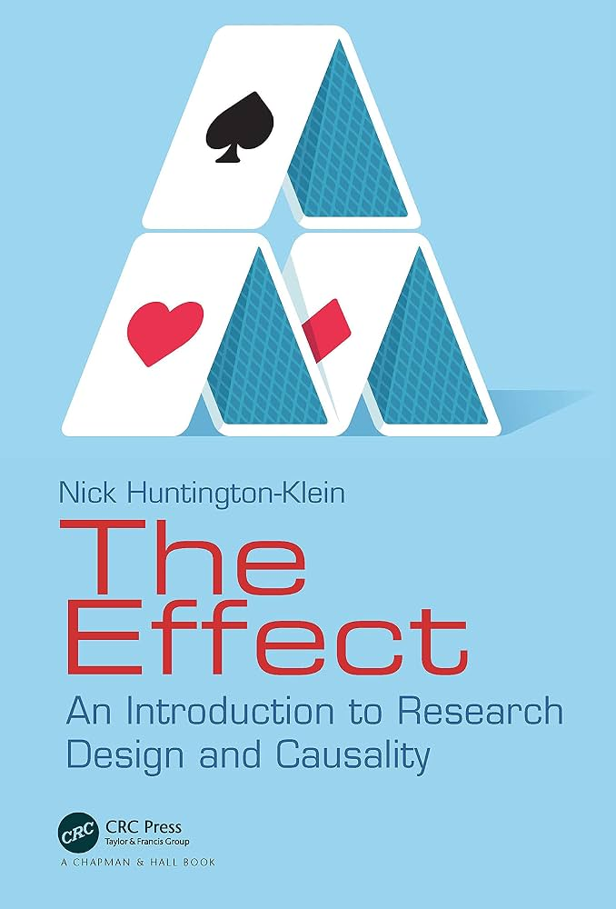
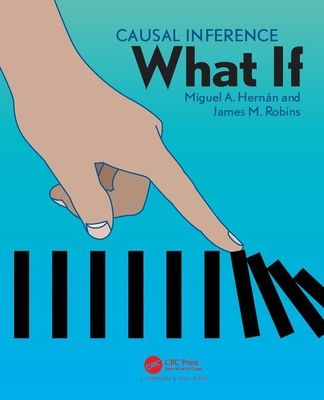
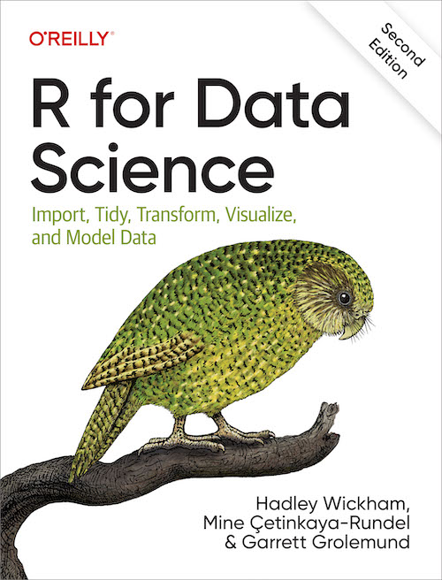

</a>

[Huntington-Klein, N. (2025). *The Effect: An Introduction to Research Design and Causality.* Chapman and Hall/CRC.](https://www.theeffectbook.net/index.html)

####

[Barrett, M., McGowan, L.D., & Gerke, T. (2026). *Causal Inference in R*](https://www.r-causal.org)

</a>

####

[Hernán MA, Robins JM (2020). *Causal Inference: What If*. Boca Raton: Chapman & Hall/CRC](https://static1.squarespace.com/static/675db8b0dd37046447128f5f/t/6a86cf7ecfcb6b4ca8eea5cb/1787219838424/hernanrobins_WhatIf_19aug26.pdf)

  

## Other Reference Books

<!-- R for Data Science -->

</a>

Wickham, H., Çetinkaya-Rundel, M., & Grolemund, G. (2025). *R for Data Science (2nd Ed).*

> This is an open source textbook that [can be accessed on the web](https://r4ds.hadley.nz), or a printed copy can be ordered from [Amazon](https://www.amazon.com/Data-Science-Transform-Visualize-Model/dp/1492097403/ref=sr_1_1?crid=M79ETHG57G1L&dib=eyJ2IjoiMSJ9.Z1c-Zpi4mNudjpLRyuLhdiV-vmTQxsTksawK5qZqUgg7eerNQQSJqvZp3BkffxdM1ox_XNzTabFcY05ICFTkf9ncIVj_IEWz1rhWS2gil8nY-LPqz9c-dloObLA3FnLDg5WOQe992bNxxijiuIFnKK0Ey5QraCvJOh0cXEAbtlptBwb7o9NXvcvzUuFLoQAPthbWbSUmBMcqVkX2GsQLYhi_T3gUNKggad08D7zUCfs.VwIG-MY-f-HOH75xjof58egaEoy8hhNzLAZxBsV1lT4&dib_tag=se&keywords=r+for+data+science&qid=1741917409&sprefix=r+for+dat%2Caps%2C138&sr=8-1).

